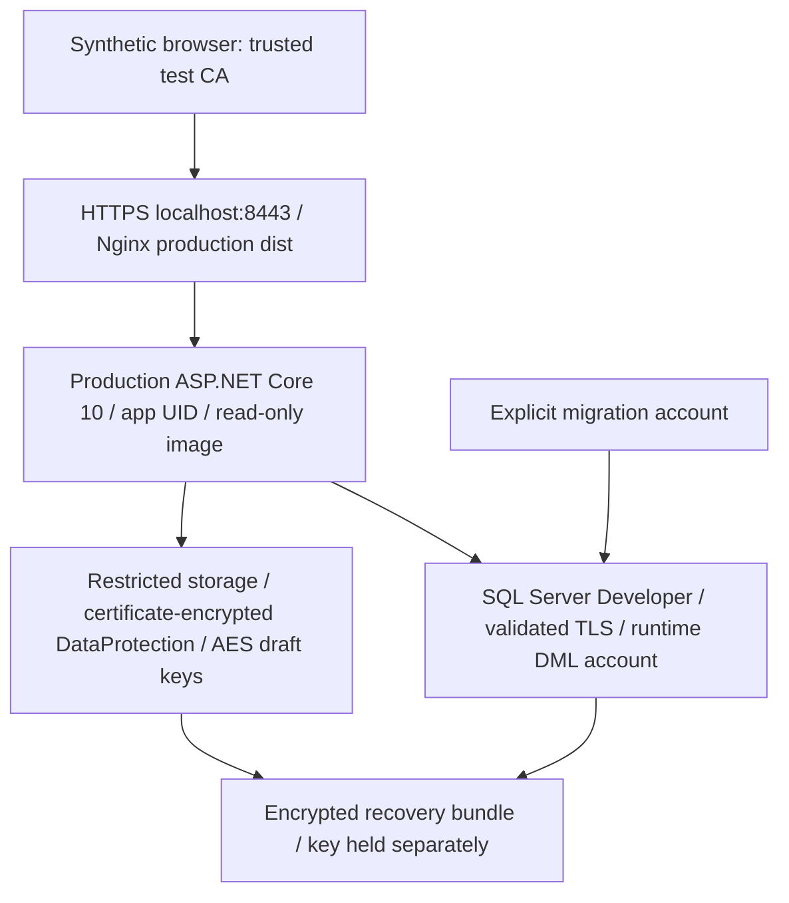

# Gate 6B — isolated staging, recovery and internal pilot

Starting main: `2552252d0d916d4184d88482f3649c602468eff8` (merged Gate 6A PR #19).
Branch: `codex/universal-doc-engine-gate-6b-staging-pilot`. One Draft PR; no merge.

**Current verdict: PARTIAL / NO-GO.** Implementation is under exact-HEAD verification. [PR #20](https://github.com/Nhutduyasda/ShoeDocX/pull/20) records the final SHA, both host runs and immutable artifact links; executed artifact outcomes override this implementation snapshot.
Do not interpret the presence of a workflow, runbook or test scenario as a passing result.
The authoritative executed result is the same-HEAD `gate6b-regression.json` for each OS
and `gate6b-staging.json` for Linux. CI fails closed while any staging acceptance is
incomplete. No hosted staging or real participant pilot exists.

| Milestone | Status | Evidence / limit |
|---|---|---|
| Main merge and open PR preflight | Tested | Main matches requested baseline; only excluded #4/#13/#14 open at start |
| Production configuration and explicit initialization | Implemented | No ordinary Production DbInitializer writes; both migration chains checked |
| Certificate protected DataProtection key ring | Implemented | Independent protection PFX injected, separate from ingress TLS key; private key outside image; exact-HEAD report required |
| DataProtection certificate rollover | Implemented | Active encryption certificate plus up to four historical decryption certificates; synthetic rollover and early-retirement tests require exact-HEAD evidence |
| HTTPS reverse proxy and SQL certificate validation | Implemented | Ephemeral test CA, forced SQL TLS; execution pending |
| Runtime least privilege | Implemented | DML roles, no db_owner or CREATE TABLE, history writes denied; execution pending |
| Encrypted backup and complete instance reconstruction | Implemented | SQL CHECKSUM + AES-GCM bundle + ciphertext fingerprint; execution pending |
| Full fault injection / rollback | Implemented | Explicit Production fault probes and immutable previous-build probe; exact-HEAD outcome required |
| Hardened two-version rollback | Implemented | Frozen b0604b9 A and later B, same database/key ring, startup row hashes and fresh authorized exports; current CI required |
| Actual disk exhaustion | Implemented | Only 8 MiB ingress / 64 MiB backend tmpfs filled to ENOSPC, failed-upload atomicity, in-memory exports, readiness and capacity recovery; current CI required |
| Windows native Production | Blocked | Earlier LocalDB observation used named pipes with encrypt_option FALSE; hardened Production rejects IPC / implicit transport |
| Windows production SQL TLS parity | Blocked | LocalDB has no verified managed TCP TLS endpoint / separate runtime SQL login / native proxy parity |
| Real office participant pilot | Owner approval required | INTERNAL PILOT NOT YET EXECUTED |
| Hosted staging | Owner approval required | No resource provisioned, existing production assets untouched |
| Production | Blocked | NO-GO |

## Architecture

Only one host loopback port is published. SQL/API have no host port. The API/SQL Docker
network is internal; only Nginx also joins a separate ingress bridge for the loopback
port publication. Internal-only containers do not provide a reliable published ingress. The proxy replaces client X-Forwarded-* values; the backend
accepts one hop from the exact configured proxy IP, never all peers. Host is fixed
by ingress; AllowedHosts is explicit. Health emits only ready/503 plus a constant storage-probe capability header. Swagger remains
Development-only. Frontend runtime is Nginx with compiled dist, no Node/Vite.

The existing root Compose and HTTP Nginx remain historical development examples,
not a supported staging launch path. Use `deploy/gate6b/compose.yml`; its certificates,
private configuration and mounts are mandatory. SQL Developer is nonproduction only.
The owner Windows computer is never used. Ordinary CI LocalDB is regression evidence,
not production TLS acceptance. Do not weaken ProductionConfiguration for it.

## Runtime changes and security review

Production requires an explicit tcp: SQL endpoint, Encrypt enabled and TrustServerCertificate false. Encrypt=True by itself does not prove TLS for local IPC. A bounded direct connection probe runs before EF startup retries and never opens a listener after a failed probe.

Production also requires a certificate path for DataProtection, loads the PFX through
X509CertificateLoader and protects persisted key material. Missing/unreadable/wrong
PFX fails startup. PFX/private password and AES keys require protected operator storage;
file persistence alone does not protect their master secrets. Backups wrap the complete
recovery set in authenticated AES-256-GCM. Backup decryption key is separate and is
not included in the archive or artifacts. Test CA and credentials are random ephemeral
synthetic secrets, never reusable deployment credentials.

Normal Production startup checks legacy and draft pending migrations and draft model
state, then performs integrity reads. It no longer runs default workspace/template/
folder repair. `--migrate-all` requires Database:MaintenanceAuthorized, migrates legacy
and `ude.__DraftMigrations`; `--initialize-staging` separately performs initialization.
BootstrapAdmin in Production requires the explicit initialization command. Development
seeding remains Development-only and explicitly enabled; staging disables it. Old
`--migrate-only` is not the Gate 6B maintenance procedure and cannot be used to bypass
normal production migration policy.

Application sessions are memory-only and are lost on restart. Drafts persist for
exactly seven days from creation and must be resumed, remapped/reconfirmed, reviewed
and approved again. Approval is never restored as export permission. No decoder,
OCR, PDF compatibility, paid inference or roadmap scope expansion is included.

Gate 6A Option A remains in force: Tailwind 3.4.17 with the reviewed deduplicated
postcss-selector-parser 6.1.5. Keep complete audit output and GHSA-rj75-hqrm-r3gf
warning visible; do not claim a clean full audit. Recheck official feeds, package
hashes, trusted-source compiler inputs and absence of runtime compilation. No new
Critical/High is accepted. Lockfile and application UI are unchanged by Gate 6B.

## Acceptance inventory and honest gaps

Dual-OS regression rebuilds all project inventories, compares exact test identities
and normalized failure hashes with this run's accepted-main checkout, requires all
added Gate 6B tests pass and zero skipped tests, rebuilds the frontend, audits official
dependencies, verifies backport bytes and runs inherited authenticated browser suites.
This does not substitute for production staging acceptance.

Linux staging builds real images, validates nonroot/read-only/no-backend-port metadata,
executes explicit migrations, authenticates actual SQL Identity users, runs invoice, warehouse and multi-sheet Office
Wizard flows with local synthetic fixture files through HTTPS, and uses no test routes or
mocked API responses in the Production process. Browser certificate errors are not
ignored. Restored workbook downloads are reopened by ClosedXML and openpyxl. Raw
workbooks, screenshots, tokens, private configuration and logs are private runner temp
only. Uploaded artifact paths contain explicit sanitized metadata JSON only.

The scripted complete-instance recovery saves a two-sheet workflow and uses a controlled pause point while browser
waits: graceful backend stop, ciphertext/key/rowversion fingerprint, SQL backup with
checksum, authenticated encrypted recovery archive, destruction of application/SQL
containers and database volume, reconstruction, VERIFYONLY/RESTORE, login SID remap,
protected keys and file mounts restored, fingerprint equality, fresh authentication,
draft resume, renewed approval and export. If this has not completed in CI it remains
**Not tested**. RTO is an observation only when emitted; no SLA or guaranteed RPO.

Implemented mandatory Production probes cover SQL outage/auth failure/wrong TLS,
missing AES key/wrong key ID, incorrect DataProtection certificate/old CSRF rejection,
corrupt authenticated archive and SQL backup, missing attachment/template storage,
incomplete configuration, expired restored drafts, concurrent updates and a real held
SQL transaction lock, storage permission denial, client interruption during download
and revision-refreshed authorized retry with identical cell/style fingerprints, expired/revoked JWT, missing/invalid CSRF,
unauthorized reviewer/approver/export, cross-owner/cross-tenant drafts, a real twenty-
minute session expiry with no clock override, invalid/oversized/unsupported formula/
structure/reference changes, and rollback to the immutable accepted Gate 6A build.
Only actual same-HEAD artifact PASS entries count as executed acceptance. Directory
permission denial is not a full-disk simulation. The bounded tmpfs test requires
actual ENOSPC and verifies ingress failure before template commit, encrypted draft
integrity, temporary-file cleanup and capacity restoration. The Excel API deliberately
buffers bounded uploads/exports in memory: exports that succeed while temporary disk
is full are resilience evidence, not an invented export-failure claim. Candidate B
readiness rejects unavailable temporary storage with 503. Current CI evidence is required.
The rollback probe copies the key ring, preserves the live encrypted draft, uses a
separate loopback ingress and reports functional XLSX recovery independently from
whether the old build maintains hardened key protection. Gate 6A is not preapproved
as a hardened rollback target. A functional rollback does not waive its startup-write
or key-encryption limitations. These blockers keep the PR Draft.

A separate hardened release exercise freezes reviewed b0604b9 source and its fresh
immutable image ID as A, uses the current candidate with temporary-storage readiness
as B, then runs A-create/save/export -> B-upgrade/resume/reapprove/export -> A-rollback/
resume/reapprove/export. The live SQL instance, certificates, key XML and ciphertext
after the legitimate A save are preserved. All user-table row hashes are compared
across startup. Real twenty-minute expiry runs while B is active; SQL leases expire
naturally. Its result is gate6b-hardened-rollback.json. This is distinct from the
rejected Gate 6A probe, complete backup restoration, forward recovery and production rollback.

The signed-Express Windows investigation records exact installer phase, signatures,
hashes and any executed native TCP/TLS/HTTPS/auth/CSRF subset. Full native reverse-proxy,
unprivileged application identity, browser, tenant/owner and draft recovery parity
are not inferred from a subset. No Windows requirement is waived. See the
[platform-scope and restricted rollback decision package](gate6b/PLATFORM_DECISION.md).
The owner must approve any Linux-only pilot scope and initial-release rollback policy.

## Handoff

- [Infrastructure, pricing and hosting approval](gate6b/INFRASTRUCTURE.md)
- [Operator runbooks and secrets](gate6b/OPERATIONS.md)
- [Vietnamese quick-start and participant checklist](gate6b/PILOT_VI.md)
- [Feedback and incident templates](gate6b/FEEDBACK.md)
- [Pending platform, rollback and concrete pilot decisions](gate6b/PLATFORM_DECISION.md)

Final acceptance must report separately STAGING TECHNICAL PASS/PARTIAL/FAIL,
INTERNAL PILOT PASS/NOT EXECUTED/FAIL, PR MERGE READY/NOT READY, PRODUCTION GO/NO-GO.
Current claims remain PARTIAL, NOT EXECUTED, NOT READY, NO-GO until executed evidence
and explicit participant authorization support a change. No invitations, real user
accounts, access URL distribution, company files, cloud changes or production migrations.
